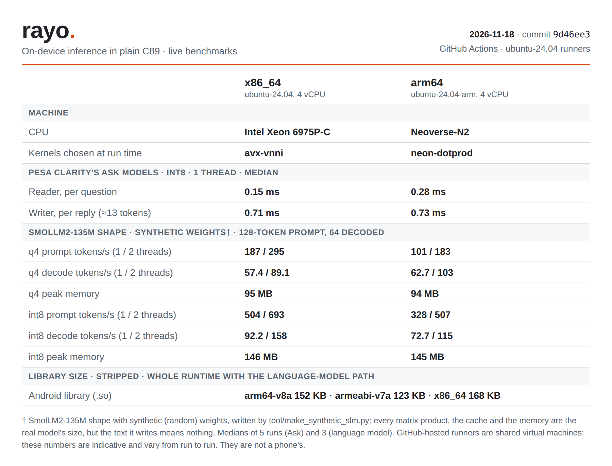

# rayo benchmarks

Written by CI after every push to `main` ([`.github/workflows/ci.yml`](https://github.com/pesaclarity/rayo/blob/main/.github/workflows/ci.yml), `bench` and `bench-publish`); nothing here is edited by hand. GitHub-hosted runners are shared virtual machines: these numbers are indicative and vary from run to run. They are not a phone's.

<picture>
  <source media="(prefers-color-scheme: dark)" srcset="table-dark.png">
  
</picture>

## Latest: 2026-11-18, [`9d46ee3`](https://github.com/pesaclarity/rayo/commit/9d46ee3d660190c255d58513d2e358031f57a283)

| | **x86_64** ubuntu-24.04, 4 vCPU | **arm64** ubuntu-24.04-arm, 4 vCPU |
| --- | --- | --- |
| **Machine** | | |
| CPU | Intel Xeon 6975P-C | Neoverse-N2 |
| Kernels chosen at run time | avx-vnni | neon-dotprod |
| **Pesa Clarity's Ask models · int8 · 1 thread · median** | | |
| Reader, per question | 0.15 ms | 0.28 ms |
| Writer, per reply (≈13 tokens) | 0.71 ms | 0.73 ms |
| **SmolLM2-135M shape · synthetic weights† · 128-token prompt, 64 decoded** | | |
| q4 prompt tokens/s (1 / 2 threads) | 187 / 295 | 101 / 183 |
| q4 decode tokens/s (1 / 2 threads) | 57.4 / 89.1 | 62.7 / 103 |
| q4 peak memory | 95 MB | 94 MB |
| int8 prompt tokens/s (1 / 2 threads) | 504 / 693 | 328 / 507 |
| int8 decode tokens/s (1 / 2 threads) | 92.2 / 158 | 72.7 / 115 |
| int8 peak memory | 146 MB | 145 MB |
| **Library size · stripped · whole runtime with the language-model path** | | |
| Android library (.so) | arm64-v8a 152 KB · armeabi-v7a 123 KB · x86_64 168 KB |  |

† SmolLM2-135M shape with synthetic (random) weights, written by tool/make_synthetic_slm.py: every matrix product, the cache and the memory are the real model's size, but the text it writes means nothing.

The run: https://github.com/pesaclarity/rayo/actions/runs/44269079067

## History (the last 10 runs; all in [history.csv](history.csv))

| date | commit | runner | reader ms | writer ms | q4 decode tok/s 1 / 2 threads | int8 decode tok/s 1 / 2 threads |
| --- | --- | --- | --- | --- | --- | --- |
| 2026-11-18 | [`9d46ee3`](https://github.com/pesaclarity/rayo/commit/9d46ee3d660190c255d58513d2e358031f57a283) | ubuntu-24.04-arm | 0.3 | 0.7 | 62.7 / 103 | 72.7 / 115 |
| 2026-11-18 | [`9d46ee3`](https://github.com/pesaclarity/rayo/commit/9d46ee3d660190c255d58513d2e358031f57a283) | ubuntu-24.04 | 0.1 | 0.7 | 57.4 / 89.1 | 92.2 / 158 |

Each run's full numbers (CPU flags, p90s, per-step times, file sizes) are in [results/](results/), one JSON file a run; the oldest are removed as new ones come.
